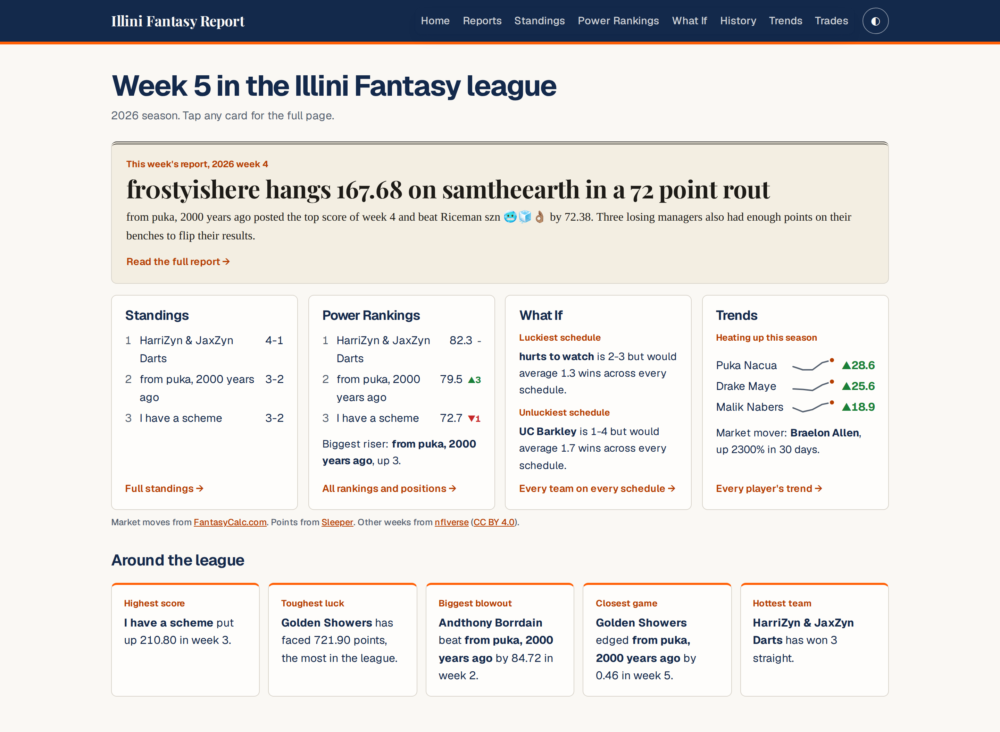

# Illini Fantasy Report

A newspaper-style website for the Illini Fantasy Football League, a 12-team league on Sleeper. Every week brings a new recap of the action, and standings, rankings, and player trends refresh daily with no manual work.

**Live site:** [illini-fantasy-report.pages.dev](https://illini-fantasy-report.pages.dev)



## Features

### Weekly report
A sports-page recap of every week, written by Claude from facts computed out of Sleeper data. Each issue covers every matchup, the player and bust of the week, bench blunders, power ranking risers and fallers, transactions, injuries, trending players, and picks for next week. The model only receives computed facts, so every number in a report comes from the league data. Reports can be saved as a PDF or as a shareable image, and each one gets its own link preview card.

### Standings
The league table with records, points for and against, streaks, recent form, and league ranks for scoring.

### Power rankings
A composite score built from all-play win percentage, total points, and recent scoring, with week-over-week movement and positional rankings for QB, RB, WR, TE, K, and DEF.

### What If
A schedule-swap matrix that shows every team's record had it played every other team's schedule, highlighting the luckiest and unluckiest teams. On phones it collapses into an expandable list.

### Trends
Form for every rostered player: recent weeks against earlier ones, 30-day trade market movement, last season for comparison, and Buy low and Sell high tags for players scoring well below or above what their usage usually produces.

### Trade Finder
Suggested trades that improve both teams' starting lineups while keeping player values close.

### League history
Every season in the league's history, with all-time records, champions, drafts, and a page for each champion's title run.

### Design
- Reports use a newspaper layout with a blackletter masthead, serif body text, a drop cap, and multi-column articles.
- Illinois orange and blue, with light and dark modes.
- Built mobile first, from 360px phones up to desktop.
- Fully static output that ships almost no JavaScript, with a strict Content Security Policy.

## How it works

The site is built with [Astro](https://astro.build) as a fully static site and hosted on Cloudflare Pages. All league data is fetched from the [Sleeper API](https://docs.sleeper.com) at build time, so the browser never calls an outside service.

| Job | Schedule | What it does |
|---|---|---|
| Daily refresh | Every morning | Updates player, usage, and trade data, then rebuilds the site so standings and rankings stay current |
| Weekly report | Tuesdays | Drafts the week's recap with Claude Code and opens a pull request for the commissioner to review and merge |
| CI | Every pull request | Runs tests, type checks, a production build, a dependency audit, a style check on every report, and a scan for leaked secrets |

A small Cloudflare Worker in `workers/refresh-cron` acts as a backup scheduler and starts either job if GitHub drops its scheduled run.

## Getting started

Requirements: Node 22 or newer and npm 11.

```sh
git clone https://github.com/gagank02/illini-fantasy-report.git
cd illini-fantasy-report
npm install
cp .env.example .env
npm run dev
```

The site runs at `http://localhost:4321`. The only setting needed locally is `SLEEPER_LEAGUE_ID`, which `.env.example` already provides.

### Scripts

| Command | Description |
|---|---|
| `npm run dev` | Start the local development server |
| `npm run build` | Build the static site into `dist/` |
| `npm run preview` | Serve the production build locally |
| `npm test` | Run the test suite with Vitest |
| `npm run check` | Type check the project |
| `npm run report` | Draft a weekly report with Claude Code |
| `npm run lint:report` | Check a report against the style rules in `writing-style.md` |

## Project structure

```
src/
  pages/        Site pages: home, reports, standings, power rankings, what if, trends, trades, history
  lib/          Data fetching and league statistics
  components/   Shared UI components
  content/      Weekly reports in Markdown
  data/         Data files committed by the daily refresh
scripts/        Data refresh and report writing scripts
workers/        Cloudflare Worker that backs up the scheduled jobs
tests/          Vitest suite
```

See [SPEC.md](SPEC.md) for the full product specification.

## Data and credits

- League data, injuries, and trending players from [Sleeper](https://sleeper.com).
- Trade values and market movement from [FantasyCalc.com](https://fantasycalc.com).
- Player usage and expected points from [nflverse](https://github.com/nflverse) (CC BY 4.0) and [ffopportunity](https://github.com/ffverse/ffopportunity) (CC BY-SA 4.0).

This is a fan site. It is not affiliated with or endorsed by the University of Illinois, Sleeper, FantasyCalc, or the NFL.
